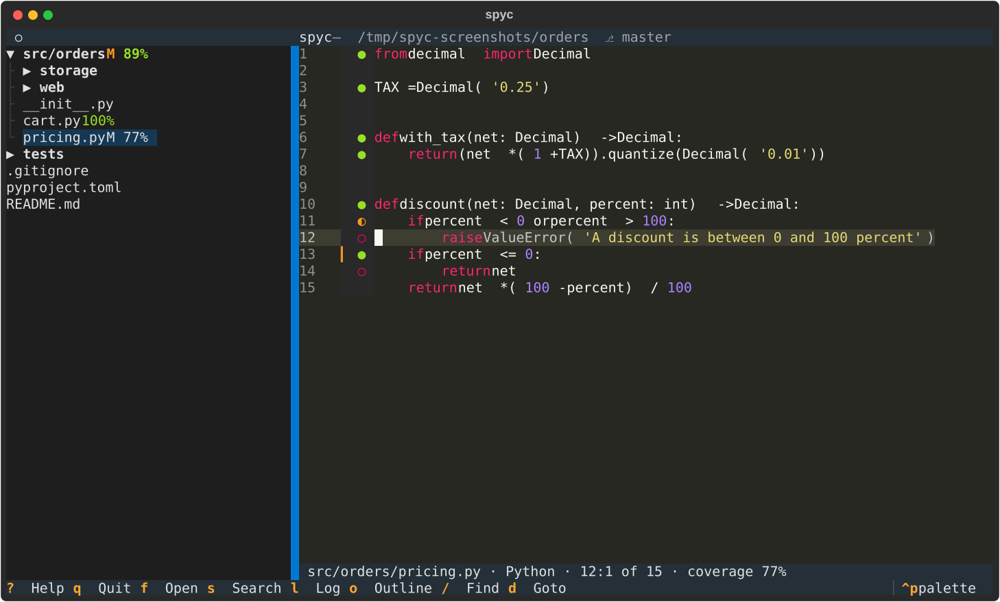
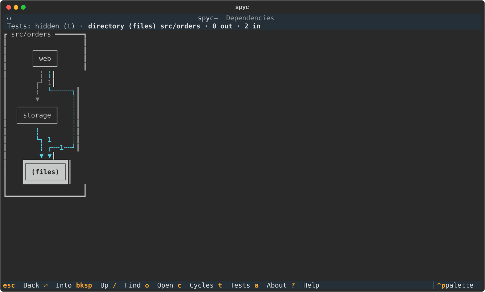

# spyc

[](https://github.com/adeptum-labs/spyc/actions/workflows/tests.yml)
[](https://github.com/adeptum-labs/spyc/actions/workflows/release.yml)
[](https://github.com/adeptum-labs/spyc/releases)

spyc is short for "spy code": a terminal viewer for browsing code bases. It finds the project you point it at, shows an
overview of it, lists the files as a tree, colors the code, shows the history from git, and is meant to be the tool you
open a code base with.



More screenshots, of the overview and the commit log, are in the
[wiki](https://github.com/adeptum-labs/spyc/wiki/Screenshots).

## Requirements

- Python 3.11 or later, when installing from source
- `git` on the path (lists the files of a project and gives the history, changes and blame)
- `rg` (ripgrep) is optional: it makes the search of the whole project fast and is needed for pattern search; without
  it the files are read in Python and the search is literal
- `claude` (Claude Code) is optional: when it is on the path and logged in, `a` describes a directory, package, file or
  class

## Install

Each release has a Debian package and a single-file executable for `amd64` and `arm64`. They are built on Debian 12
and run on Debian 12 and later and on Ubuntu 24.04 and later (they need glibc 2.36), and need no Python.

```sh
sudo apt install ./spyc_0.1.0-1_amd64.deb     # brings git, and ripgrep as a recommendation
chmod +x spyc-linux-amd64 && ./spyc-linux-amd64   # or the executable, which needs only git
```

The executable unpacks itself into a temporary directory on each start, so it starts a little slower than the
installed package. From source, `pip install .` gives the `spyc` command.

## Usage

```sh
spyc                       # the current directory
spyc path/to/dir           # a directory
spyc path/to/file.py:42    # a file, opened at line 42
spyc --coverage lcov.info  # show what a coverage report says; may be given more than once
```

`spyc` opens at the root of the project that contains the path: the git top level, or else the nearest directory with
a build file such as `pom.xml`, `Cargo.toml`, `go.mod` or `pyproject.toml`. The overview shows the languages by size,
the build systems and the key files, such as the README, the build files, the CI configuration and the entry points.

## Keys

`f` finds a file, `s` searches the project, `o` and `t` find definitions and `d` goes to one. `l` is the commit log,
`B` the branches, `g` the uncommitted changes and `b` the blame. `G` draws the dependency graph, `c` shows coverage and
`a` asks Claude. `?` lists every key inside spyc, and the [wiki](https://github.com/adeptum-labs/spyc/wiki/Keys) has
the full reference.

## Dependencies



`G` draws the dependencies of the project as boxes in layers: what depends on something is above it, and a dashed line
with a number, the files behind it, runs from each box to the ones it depends on. `Enter` goes into a box and shows its
parts. Test files are left out until `t` shows them. Java, Kotlin, Python, JavaScript, TypeScript, TSX, Go, Rust, C and C++ are read. How each language is read and
what the graph cannot see is described in the [wiki](https://github.com/adeptum-labs/spyc/wiki/Dependencies).

## Asking Claude

`a` has Claude describe what is selected: a directory, a file, a class or a box in the dependency graph. The key exists
only when `claude` is on the path and logged in. Claude gets read-only tools (`Read`, `Grep`, `Glob`) and answers are
cached per project. More in the [wiki](https://github.com/adeptum-labs/spyc/wiki/Asking-Claude).

## Coverage

spyc reads LCOV, Cobertura, JaCoCo XML and Go cover profiles, found in the project or named with `--coverage`. The
margin marks the lines that ran, ran in part or never ran, and the tree and the overview give the shares. More in the
[wiki](https://github.com/adeptum-labs/spyc/wiki/Coverage).

## Colors

The code is colored with tree-sitter grammars for the common languages and with Pygments for the rest, in a theme
chosen in the command palette. The languages are listed in the [wiki](https://github.com/adeptum-labs/spyc/wiki/Colors).

## Files

`state.json` (recent files, theme, sidebar) and `spyc.log` (warnings) are kept in `$XDG_STATE_HOME/spyc`, by default
`~/.local/state/spyc`. What is read from the code of a project (definitions and imports) is cached per project in
`$XDG_CACHE_HOME/spyc`, by default `~/.cache/spyc`, and can be deleted at any time.

## License

Copyright © 2026 Adam Waldenberg, Adeptum AB. Licensed under the GNU General Public License, version 3 or later.
See [LICENSE](LICENSE).
